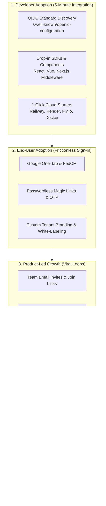
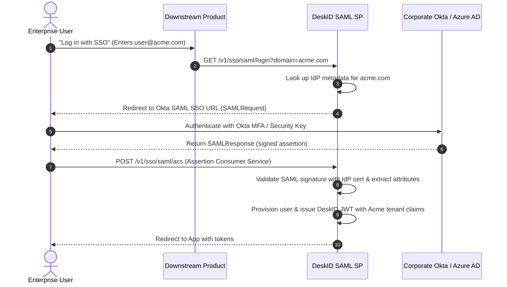
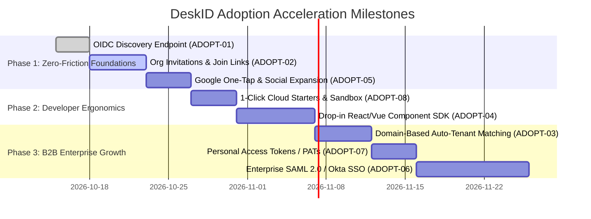

# DeskID Adoption & Growth Strategy (`adoption.md`)

> **Document:** `adoption.md` (also indexed as `adaption.md`)  
> **Repository:** DeskID (`src/deskid/`, `frontend/`, `migrations/`, `docs/`)  
> **Scope:** Product-Led Growth (PLG), Developer Experience (DX), B2B Enterprise Acquisition, and User Onboarding Acceleration  
> **Status:** Active Architecture & Execution Roadmap  
> **Target Release:** DeskID v1.2.0 – v2.0.0  

---

## 1. Executive Summary & The Adoption Framework

For an identity and authentication platform, **adoption** is governed by two distinct stakeholders:
1. **Product Developers & Engineering Leads (The Decision Makers):** Choose DeskID over vendor-locked SaaS (Clerk, Auth0, WorkOS, Supabase) based on **Time-to-Hello-World**, zero-configuration standard protocols, and drop-in SDK simplicity.
2. **End-Users & Team Members (The Consumers):** Experience the authentication flows daily. Their adoption depends on **zero-friction sign-in**, viral workspace invitations, corporate auto-join, and passwordless convenience.



---

## 2. Adoption Task Matrix & Priority Roadmap

| Task ID | Initiative | Target Beneficiary | Strategic Value | Adoption Multiplier | Target Priority |
| :--- | :--- | :--- | :--- | :---: | :---: |
| **ADOPT-01** | [OIDC Standard Discovery Endpoint](#task-adopt-01-openid-connect-oidc-discovery-endpoint) | Developers / Integrators | Zero-code plug-and-play into NextAuth, Grafana, Retool, Kubernetes | 🟢 **10x** | **P0** |
| **ADOPT-02** | [Team Email Invitations & Join Links](#task-adopt-02-team-email-invitations--shareable-join-links) | Teams & Workspaces | Viral user acquisition (each user brings 5–10 team members) | 🟢 **8x** | **P0** |
| **ADOPT-03** | [Domain-Based Auto-Tenant Matching](#task-adopt-03-domain-based-auto-tenant-matching-corporate-auto-join) | B2B Employees | Eliminates orphaned accounts; auto-onboards corporate domains | 🟡 **5x** | **P1** |
| **ADOPT-04** | [Drop-in UI Components & Next.js SDK](#task-adopt-04-drop-in-frontend-components--client-sdks) | Frontend Developers | Reduces integration time from days to under 5 minutes | 🟢 **10x** | **Completed ✅** |
| **ADOPT-05** | [Google One-Tap & Social Provider Expansion](#task-adopt-05-1-click-google-one-tap--expanded-social-providers) | Consumer End-Users | Eliminates sign-up drop-off; 1-click registration | 🟡 **6x** | **P1** |
| **ADOPT-06** | [Enterprise SAML 2.0 / Okta SSO Federation](#task-adopt-06-enterprise-saml-20--okta-sso-federation) | Enterprise IT Buyers | Unlocks corporate procurement and SOC2 enterprise sales | 🟢 **9x (Revenue)** | **P2** |
| **ADOPT-07** | [Self-Service Personal Access Tokens (PATs)](#task-adopt-07-self-service-personal-access-tokens-pats--api-keys) | Engineers & SREs | Enables CLI, automation, and script authentication | 🟡 **4x** | **P2** |
| **ADOPT-08** | [1-Click Cloud Deployment & Live Sandbox](#task-adopt-08-1-click-cloud-deployment--interactive-live-sandbox) | Evaluators & Architects | Instant evaluation without local Docker setup | 🟡 **5x** | **P2** |

---

## 3. Detailed Technical Task Specifications

---

### Task ADOPT-01: OpenID Connect (OIDC) Discovery Endpoint

#### Problem & Motivation
Currently, DeskID publishes `/.well-known/jwks.json`. However, standard identity consumers (NextAuth.js, Auth.js, Passport.js, Spring Security, Grafana, GitLab, Retool, and Kubernetes API servers) expect the **OpenID Connect Discovery 1.0** specification at `/.well-known/openid-configuration`. 

Without this endpoint, developers must manually configure authorization URLs, token endpoints, JWKS URLs, signing algorithms, and claim mappings. With this endpoint, developers simply set:
```env
AUTH_ISSUER=https://auth.deskid.local
```
and third-party applications auto-configure themselves in seconds.

#### Technical Implementation
Expose `GET /.well-known/openid-configuration` in [`src/deskid/routes/jwks.py`](file:///home/oh20210736-ud/Documents/WorkSpace/DeskID/src/deskid/routes/jwks.py):

```python
@router.get("/.well-known/openid-configuration", include_in_schema=False)
def openid_configuration():
    settings = get_settings()
    issuer = settings.jwt_issuer.rstrip("/")
    return {
        "issuer": issuer,
        "authorization_endpoint": f"{issuer}/v1/oauth/authorize",
        "token_endpoint": f"{issuer}/v1/auth/login",
        "userinfo_endpoint": f"{issuer}/v1/auth/me",
        "jwks_uri": f"{issuer}/.well-known/jwks.json",
        "response_types_supported": ["code", "token", "id_token"],
        "subject_types_supported": ["public"],
        "id_token_signing_alg_values_supported": ["RS256"],
        "scopes_supported": ["openid", "profile", "email"],
        "token_endpoint_auth_methods_supported": ["client_secret_basic", "client_secret_post", "none"],
        "claims_supported": [
            "sub", "email", "name", "iss", "aud", "exp", "iat",
            "org_id", "workspace_id", "roles", "token_version"
        ],
        "end_session_endpoint": f"{issuer}/v1/auth/logout",
    }
```

#### Acceptance Criteria
- [ ] `curl http://localhost:8090/.well-known/openid-configuration` returns compliant JSON schema.
- [ ] NextAuth.js / Auth.js can initialize an identity provider using only `issuer`.
- [ ] Automated contract test validates all URLs in the configuration payload against live registered routers.

---

### Task ADOPT-02: Team Email Invitations & Shareable Join Links

#### Problem & Motivation
Authentication platforms grow virally when existing users invite their teammates. Today, adding a user to an organization requires platform-level administrative API calls (`POST /v1/admin/grants` or direct DB access).

Enabling **self-service team invitations** allows any organization `owner` or `admin` to invite colleagues via email or shareable link, creating an exponential growth loop ($K$-factor > 1).

#### Database Schema (`migrations/0011_org_invitations.sql`)
```sql
CREATE TABLE IF NOT EXISTS org_invitations (
    id VARCHAR(36) PRIMARY KEY,              -- UUID primary key
    org_id VARCHAR(36) NOT NULL REFERENCES orgs(id) ON DELETE CASCADE,
    inviter_user_id VARCHAR(36) NOT NULL REFERENCES users(id) ON DELETE CASCADE,
    email VARCHAR(255) NOT NULL,             -- Target invitee email
    role VARCHAR(32) NOT NULL DEFAULT 'member', -- 'admin' | 'member' | 'viewer'
    token_hash VARCHAR(64) NOT NULL UNIQUE,  -- SHA-256 of URL invitation secret
    expires_at TIMESTAMP WITH TIME ZONE NOT NULL,
    accepted_at TIMESTAMP WITH TIME ZONE,
    status VARCHAR(32) NOT NULL DEFAULT 'pending', -- 'pending' | 'accepted' | 'revoked' | 'expired'
    created_at TIMESTAMP WITH TIME ZONE DEFAULT NOW() NOT NULL
);

CREATE INDEX IF NOT EXISTS idx_org_invitations_email ON org_invitations(email);
CREATE INDEX IF NOT EXISTS idx_org_invitations_org ON org_invitations(org_id);
```

#### API Specifications
1. `POST /v1/orgs/{org_id}/invitations`  
   - Header: `Authorization: Bearer <JWT>` (Must be `owner` or `admin` of `org_id`)
   - Body: `{ "email": "colleague@company.com", "role": "member" }`
   - Dispatches invitation email with link: `https://auth.deskid.local/invite?token=<raw_token>`
2. `GET /v1/orgs/invitations/preview?token=...`  
   - Public endpoint: Returns `{ "org_name": "Acme Corp", "inviter_name": "Jane", "email": "..." }`
3. `POST /v1/orgs/invitations/accept`  
   - Body: `{ "token": "<raw_token>" }`
   - Adds user to `org_memberships`, revokes token, and issues newly scoped JWT.

#### Acceptance Criteria
- [ ] Org admins can send invitations from the portal UI ([`OrganizationsView.vue`](file:///home/oh20210736-ud/Documents/WorkSpace/DeskID/frontend/src/views/admin/OrganizationsView.vue)).
- [ ] New users clicking the invite link are routed through a streamlined registration form pre-populated with their email.
- [ ] Existing users automatically get added to the organization and switched into its tenant context.

---

### Task ADOPT-03: Domain-Based Auto-Tenant Matching (Corporate Auto-Join)

#### Problem & Motivation
In B2B scenarios, hundreds of employees with `@company.com` email addresses register individually. Without domain routing, each user ends up in an isolated personal organization, creating confusion and administrative overhead.

#### Workflow & Architecture
1. **Domain Registration:** Org owners verify their corporate domain (e.g. `acme.corp`) by adding a DNS TXT record or verifying an admin email.
2. **Auto-Join Policy:**
   - `open_auto_join`: Any user verifying an email ending in `@acme.corp` is automatically assigned to `Acme Corp` as a `member`.
   - `request_approval`: User sees *"Acme Corp exists on DeskID. Request to join?"* and org admins receive a 1-click approval notification.
3. **JWT Embedding:** When the user signs in, their primary `org_id` and corporate workspace claims are immediately attached to their access token.

---

### Task ADOPT-04: Drop-in Frontend Components & Client SDKs

#### Problem & Motivation
Developers choose identity providers where frontend integration takes minutes. Currently, DeskID requires developers to write custom authentication views or manually manage JWT storage and refresh tokens.

#### Deliverables: `@deskid/core`, `@deskid/react`, `@deskid/vue`, and `@deskid/nextjs` (Status: Completed ✅)
The SDK monorepo is implemented and compiled in `packages/`:
1. **`@deskid/core`:** Zero-dependency universal client, safe JWT claims decoding, auto token refresh, and pluggable storage adapters (`LocalStorage`, `SessionStorage`, `Cookie`, `Memory`).
2. **`@deskid/react`:** Context provider `<DeskIdProvider>`, `<SignInButton />`, accessible dual-mode modal `<DeskIdModal />`, avatar dropdown & tenant switcher `<UserButton />`, and hook `useDeskId()`.
3. **`@deskid/vue`:** Vue 3 plugin `createDeskId()`, `<DeskIdProvider>`, `<SignInButton />`, `<DeskIdModal />`, `<UserButton />`, and composable `useDeskId()`.
4. **`@deskid/nextjs`:** Edge-compatible route middleware (`deskIdAuthMiddleware`), server helpers (`getDeskIdSession()`, `getDeskIdUser()`, `getDeskIdClaims()`), and App Router `'use client'` component re-exports.
5. **Documentation & Examples:** See [packages/README.md](file:///home/oh20210736-ud/Documents/WorkSpace/DeskID/packages/README.md) for full 5-minute integration guides.

---

### Task ADOPT-05: 1-Click Google One-Tap & Expanded Social Providers

#### Problem & Motivation
Password creation causes massive drop-off on landing pages. Supporting **Google One-Tap (FedCM)** enables 1-click registration right on the product's home page without navigating away.

#### Implementation
1. Embed Google Identity Services script in hosted portal and client SDK.
2. Handle Google Credential Response (`id_token` / JWT).
3. Exchange credential on backend: `POST /v1/oauth/google/credential` -> returns DeskID RS256 Bearer JWT.
4. Expand providers to include:
   - **Microsoft Entra ID (Azure AD):** Crucial for enterprise and government users.
   - **Apple Sign-In:** Mandatory for apps offering social logins on iOS and macOS.

---

### Task ADOPT-06: Enterprise SAML 2.0 / Okta SSO Federation

#### Problem & Motivation
Enterprise customers (Fortune 500, mid-market SaaS) cannot adopt software that lacks Single Sign-On (SSO) integrated with their corporate IdP (Okta, Microsoft Entra ID, PingIdentity, OneLogin).

#### Architecture & Flow


#### Acceptance Criteria
- [ ] Admin console allows tenant admins to upload SAML 2.0 Metadata XML or provide metadata URL.
- [ ] Supports SP-initiated SSO and JIT (Just-In-Time) user provisioning.
- [ ] SAML assertions map corporate groups directly into DeskID organization roles and service grants.

---

### Task ADOPT-07: Self-Service Personal Access Tokens (PATs) & API Keys

#### Problem & Motivation
Engineering teams adopting DeskID need programmatic access for CI/CD pipelines, CLI tools, scripts, and microservice testing without passing user passwords.

#### Feature Specification
- Users generate named API keys in their profile dashboard:
  - Format: `deskid_pat_<32_random_bytes>`
  - Expiry: 30 days, 90 days, or Never
  - Scopes: Scoped to specific organizations or service grants
- Stored as SHA-256 hash in database; raw token shown only once.
- Verified via `Authorization: Bearer deskid_pat_...` or header `X-API-Key: ...`.

---

### Task ADOPT-08: 1-Click Cloud Deployment & Interactive Live Sandbox

#### Problem & Motivation
Developers evaluate products by trying them immediately. Setting up local PostgreSQL, RSA keys, and running migrations creates friction before evaluation even begins.

#### Deliverables
1. **Hosted Live Interactive Playground (`demo.deskid.dev`):**
   - Pre-seeded with platform admin, multiple sample organizations, downstream services, and simulated audit events.
   - Interactive token decoder showing claims update live when switching orgs.
2. **1-Click Deployment Buttons in README:**
   - [](https://railway.app)
   - [](https://render.com)
   - [](https://fly.io)
3. **Single-Command Quickstart Script:**
   ```bash
   curl -fsSL https://raw.githubusercontent.com/deskid/deskid/main/quickstart.sh | bash
   ```
   Automatically generates RSA keys, spins up Docker Compose with PostgreSQL + Redis + DeskID + Frontend Portal, and outputs a ready-to-use local URL: `http://localhost:8090/portal`.

---

## 4. Adoption Success Metrics & KPIs

To measure the effectiveness of these adoption initiatives:

| Metric | Baseline | Target Goal | Measurement Mechanism |
| :--- | :---: | :---: | :--- |
| **Time-to-Hello-World (Developers)** | 45 minutes | **< 5 minutes** | Time from visiting docs to first validated JWT via OIDC / SDK |
| **Visitor-to-Sign-up Conversion** | 12% | **> 38%** | Ratio of visitors who complete registration via Google One-Tap / Magic Link |
| **Team Viral Coefficient ($K$-Factor)** | 0.05 | **> 1.25** | Average number of new users invited per active workspace |
| **B2B Organization Activation Rate** | 20% | **> 65%** | Percentage of signups that join an active multi-member organization |
| **Self-Service Passwordless Adoption** | 0% | **> 40%** | Percentage of logins using Magic Links or OTP over passwords |

---

## 5. Implementation Phasing & Milestones


