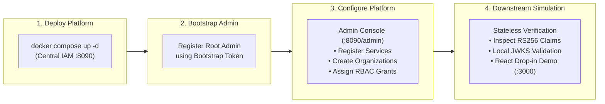
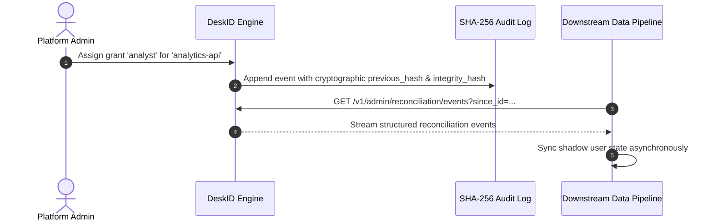

# DeskID Platform Team Showcase & Open-Source Walkthrough

> **Audience:** Open-source contributors, evaluators, platform engineers, and architects.  
> **Goal:** Run an end-to-end sandbox showcasing DeskID as a centralized identity platform and simulating downstream service integration in under 10 minutes.  
> **Status:** Standard Guide.

---

## 1. Overview & Showcase Flow

This guide walks through a complete end-to-end demonstration of DeskID from two distinct perspectives:
1. **The Platform / IAM Team:** Deploys DeskID centrally, bootstraps the primary administrator, manages multi-tenant organizations, and registers downstream product audiences.
2. **The Downstream / 3rd-Party Team:** Consumes DeskID tokens statelessly using public JWKS keys without running Docker containers or installing proprietary SDKs.



---

## 2. Phase 1: Spin Up the Central Identity Engine (2 Minutes)

DeskID packages the core authentication engine, PostgreSQL database, Redis session/rate-limit store, and modern Vue 3 administrative portal into a unified Docker Compose stack.

```bash
# 1. Clone repository
git clone https://github.com/your-org/deskid.git
cd deskid

# 2. Generate local cryptographic RSA key pair (if not already present)
openssl genpkey -algorithm RSA -pkeyopt rsa_keygen_bits:2048 -out private.pem
openssl rsa -in private.pem -pubout -out public.pem

# 3. Start the centralized platform stack
docker compose up -d
```

### Verification Endpoints:
| Service / Interface | URL | Purpose |
| :--- | :--- | :--- |
| **Public Key Registry (JWKS)** | `http://localhost:8090/.well-known/jwks.json` | Public RS256 verification keys for all downstream services |
| **Admin Console & Portal** | `http://localhost:8090/admin` | Central administrative dashboard |
| **User Sign-in / Sign-up** | `http://localhost:8090/login` | End-user authentication screens |
| **Interactive OpenAPI Docs** | `http://localhost:8090/docs` | Swagger documentation for all REST APIs |

---

## 3. Phase 2: Bootstrap as the Platform IAM Lead

When freshly deployed with an empty database, DeskID requires a secure bootstrap token to elevate the initial user to **Root Platform Admin** (`is_platform_admin = true`).

1. Open **[http://localhost:8090/register](http://localhost:8090/register)** in your browser.
2. Sign up with administrative credentials:
   - **Email:** `platform-admin@company.local`
   - **Password:** `AdminSecurePass123!`
   - **Bootstrap Token:** Enter the value configured in `AUTH_BOOTSTRAP_TOKEN` (or use the default from local dev: `local-dev-bootstrap-token`).
3. Alternatively, register via `curl`:
   ```bash
   curl -X POST http://localhost:8090/v1/auth/register \
     -H "Content-Type: application/json" \
     -d '{
       "email": "platform-admin@company.local",
       "password": "AdminSecurePass123!",
       "display_name": "Root Platform Admin",
       "bootstrap_token": "local-dev-bootstrap-token"
     }'
   ```
4. You are now authenticated as the platform lead with full administrative access.

---

## 4. Phase 3: Platform Team Ecosystem Configuration

Navigate to **[http://localhost:8090/admin](http://localhost:8090/admin)**. Here you demonstrate core identity provider governance:

### 1. Register Downstream Product Audiences
Showcase how internal and 3rd-party microservices register with IAM:
1. Navigate to **Services** ➔ Click **+ Register Service**.
2. Register an **Analytics Engine**:
   - **Audience ID:** `analytics-api`
   - **Service Name:** `Internal Data Analytics Service`
   - **Allowed Roles:** `viewer, analyst, admin`
   - **Default Role:** `viewer`
3. Register a **Billing Service**:
   - **Audience ID:** `billing-engine`
   - **Service Name:** `Subscription & Billing API`
   - **Allowed Roles:** `viewer, finance-admin`
   - **Default Role:** `viewer`

### 2. Configure Multi-Tenant Organizations
Showcase enterprise B2B multi-tenancy:
1. Navigate to **Organizations** ➔ Click **+ New Organization**.
2. Create tenant 1:
   - **Name:** `Acme Corp` (Slug: `acme-corp`)
3. Create tenant 2:
   - **Name:** `Stark Industries` (Slug: `stark-industries`)

### 3. Assign Cross-Product Grants (RBAC)
Showcase decoupled authorization:
1. Navigate to **Grants** ➔ Click **+ New Grant**.
2. Assign `analytics-api` with role `analyst` scoped to `Acme Corp`.
3. Assign `billing-engine` with role `finance-admin` globally (platform-wide).

---

## 5. Phase 4: Simulate Downstream Product Integration

Now step into the shoes of an external or downstream developer who wants to accept DeskID authentication without running Docker containers or using vendor-locked SDKs.

### 1. Inspect the Issued JWT Claims
Log into DeskID and decode the access token (e.g. via [jwt.io](https://jwt.io) or `POST /v1/auth/login`):

```json
{
  "sub": "usr_948a28f1-410a-4a41-b0e5-7b561c210d7a",
  "email": "platform-admin@company.local",
  "org_id": "org_acme_corp",
  "iss": "https://auth.deskid.local",
  "aud": ["deskid", "analytics-api", "billing-engine"],
  "roles": {
    "analytics-api": "analyst",
    "billing-engine": "finance-admin"
  },
  "exp": 1740000000
}
```

> **Key Showcase Highlight:** Notice that the audience list (`aud`) and service-specific roles (`roles`) are cryptographically sealed into the RS256 token.

### 2. Run a Standalone Downstream Verification Script
Demonstrate how a downstream service verifies requests statelessly in under 1 millisecond using standard open-source libraries:

```python
# simulate_service.py
import jwt
from jwt import PyJWKClient

# 1. Downstream service only needs the public JWKS URL
JWKS_URL = "http://localhost:8090/.well-known/jwks.json"
SERVICE_AUDIENCE = "analytics-api"

jwks_client = PyJWKClient(JWKS_URL)

def verify_request_token(raw_jwt: str):
    signing_key = jwks_client.get_signing_key_from_jwt(raw_jwt)
    claims = jwt.decode(
        raw_jwt,
        signing_key.key,
        algorithms=["RS256"],
        audience=SERVICE_AUDIENCE,
        issuer="https://auth.deskid.local"
    )
    print(f"Token Validated Statelessly!")
    print(f"User: {claims['email']}")
    print(f"Tenant: {claims.get('org_id')}")
    print(f"Assigned Role: {claims['roles'][SERVICE_AUDIENCE]}")

# Paste active token from login step
test_token = "PASTE_YOUR_JWT_HERE"
# verify_request_token(test_token)
```

---

## 6. Phase 5: Showcase Drop-in UI Components (`examples/react-demo`)

Demonstrate the Clerk-style drop-in frontend experience:

```bash
cd examples/react-demo
pnpm install
pnpm dev
```

Open **`http://localhost:3000`** to showcase:
* **`<DeskIdModal />`**: Accessible dialog supporting password, OTP, and magic link authentication.
* **`<SignInButton />`**: Single-line integration button.
* **`<UserButton />`**: Avatar component with profile display, organization tenant switching, and sign out.

---

## 7. Phase 6: Enterprise Governance & Audit Stream

Conclude the showcase by visiting **[http://localhost:8090/admin/audit](http://localhost:8090/admin/audit)**:



1. **Tamper-Evident Audit Stream:** Every administrative grant, login, password change, and tenant switch is hashed and cryptographically linked in sequence.
2. **Reconciliation Stream:** Downstream services can query `GET /v1/admin/reconciliation/events` to synchronize shadow users and revoke local permissions in real time.

---

## 8. Summary Persona Matrix

| Persona | Responsibility | Required Setup | What they interact with |
| :--- | :--- | :--- | :--- |
| **Platform / DevOps** | Central IAM Deployment | `docker compose up -d` | Docker, PostgreSQL, Redis, Domain/SSL |
| **Platform IAM Lead** | Identity Governance | Claim Bootstrap Token | Admin Console (`:8090/admin`), Services, Orgs |
| **Downstream API Team** | Service API Protection | Standard JWT library | JWKS endpoint (`/.well-known/jwks.json`) |
| **Frontend Web Team** | User Experience | Optional `@deskid/react` | `<DeskIdModal />`, `<SignInButton />` |
| **Security / Compliance** | Auditability & GDPR | None | Audit log stream (`/v1/admin/audit`) |
